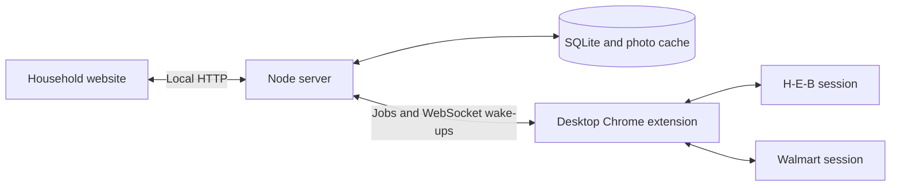

# Developing Home Grocery

[User-facing README](README.md) · [User guide](docs/USER-GUIDE.md) · [Installer build guide](installer/README.md)

This is a private repository. Contributors need repository access. Keep
installation and shopping instructions in the user guides; put implementation,
test and release details here or in the installer guide. Do not publish household
data or assume that a private repository is a safe place for credentials.

## Local source setup

Use a supported Node.js release **22.13+** with `node:sqlite`, npm, and desktop
Chrome **120+** for retailer integration. Windows is the supported installer and
Chrome-launcher platform. From a checkout:

```powershell
npm ci
npm start
```

Open http://localhost:4317. The source defaults to `.data/groceries.sqlite` and
`.data/product-images`. `npm start` uses the real default data directory if it
already exists; use an isolated directory for development and tests.

For an empty, loopback-only development household, use a separate PowerShell
terminal:

```powershell
$env:GROCERY_DATA_DIR = Join-Path $PWD '.data-dev'
$env:HOST = '127.0.0.1'
$env:PORT = '4318'
$env:GROCERY_ALIAS = '0'
npm start
```

Open http://127.0.0.1:4318. Close that terminal when finished so its environment
overrides do not carry into normal launches. Do not connect real retailer accounts
to a fixture household. The extension's supported server addresses are intentionally
restricted; alternate development ports are for backend/UI fixtures, not a
drop-in real-store connection.

The helper source is in `walmart-extension/` and supports both H-E-B and Walmart.
Load it manually with Chrome's Developer mode / Load unpacked when testing a
designated integration profile. Follow the [account setup guide](docs/USER-GUIDE.md#connect-chrome-and-your-store-accounts).
Reload the helper and store tabs after extension changes. Store authentication
and human checks require the user; do not capture or embed credentials.

## Architecture



| Area | Main files |
| --- | --- |
| Local API, state, bridge and job lifecycle | `server.js` |
| H-E-B cart and coupon jobs | `heb-cart.js`, `walmart-extension/heb-*.js` |
| Walmart requests and live cart observation | `walmart-extension/request-engine.js`, `household.js`, `cart-observer.js` |
| Receipt collection, import and paid prices | `history-import.js`, `history-prices.js`, `receipt-products.js`, extension history collectors |
| Shared product matching and routines | `household-learning.js`, `reorder.js`, `shopping-packs.js` |
| Snoozes, reusable lists, replacement preferences, price history | `shopping-tools.js` |
| Photos and store metadata jobs | `product-images.js`, `store-tasks.js` |
| Household calendar and weekly scheduler | `web/calendar.js`, `weekly-history.js` |
| Website, planning and statistics | `web/` |
| Portable host validation and local name | `network-config.js`, `local-name.js` |
| Database/photo snapshot, verification and recovery | `backup.js` |
| Windows installer, per-user launcher and uninstall | `installer/` |
| Existing scheduled-task source launcher | `start-groceries.ps1` |

Installer data is outside the code directory, under
`%LOCALAPPDATA%\HomeGrocery\data`. The installer uses a Startup shortcut; existing
source setups may use a scheduled task. The Monday 2 a.m. America/New_York schedule
belongs to the running server, not either Windows launcher. No coding app needs
to remain open.

## Changes and data integrity

- Keep jobs, carts, history and learned preferences correctly scoped by household
  connection and store. Preserve explicit review before sending drafts.
- Cart mutations are not receipts. Preserve receipt totals, discounts, weighted
  quantities and unit meaning. Never substitute current prices for paid amounts.
- Treat store pages, imported text and observed request data as untrusted. Check
  IDs, bounds, origins, URLs and image hosts before storing or acting on them.
- Do not turn uncertain cart results into success or blindly replay them. Verify
  the actual cart and protect concurrent edits. Checkout/payment remains manual.
- Use the household calendar for date-only purchases and time-based guidance.
  Preserve edited drafts during background refreshes.
- Make schema changes additive where possible. Back up before changing household
  data or schema; code rollback does not reverse database migrations.
- Keep user-facing text concrete. Internal audit terminology, debug IDs and test
  results belong in developer reports, not normal shopping flows.

## Verify changes

There is no repository-wide `npm test` script. Do not claim a test suite ran
because syntax checks passed. Use targeted backend fixtures and browser checks
appropriate to the behavior changed, and record explicit failures/incomplete checks.

Keep task-specific fixtures, runners, screenshots and reports outside the checkout
in the designated verification folder. Reuse an available shared Playwright
installation when applicable. Do not add permanent repository tests without agreement.
No real household data, retailer credentials, cookies or tokens belong in fixtures.

Use isolated databases and mocked retailer endpoints for normal cart tests.
Check account/store isolation, duplicate handling, stale/partial results, quantity
and weight behavior, and persistence. Exercise the affected UI at phone and
desktop widths and check keyboard labels, page errors and overflow. Tests must
not send real retailer changes unless that integration test is explicitly authorized.

For timing changes, simulate the household clock in an isolated child server;
never change the PC clock. Verify day rollover, daylight-saving boundaries,
missed-run catch-up and repeat-run deduplication when relevant.

Before committing, inspect `git diff`, run relevant JavaScript/PowerShell syntax
checks, and run `git diff --check`. Recheck staged paths for data or artifacts.
Restore any explicitly authorized live test changes and distinguish isolated
results from real-store verification in the contribution notes.

## Privacy and documentation

Never commit `.data`, databases, receipt exports, cached household photos, backups,
profiles, session data, diagnostic logs, local paths containing personal names,
or credentials. Ignore rules are safeguards, not a substitute for checking staged
files. Demo screenshots must use fictional data. Historical Git commits can retain
removed content; do not rewrite shared history without explicit authorization.

Keep the following documents focused:

- [README](README.md): download, screenshots, short features and quick setup.
- [User guide](docs/USER-GUIDE.md): setup and everyday use, using actual UI labels.
- [Troubleshooting](docs/TROUBLESHOOTING.md): actionable checks and known limitations.
- [Backup/recovery](BACKUP-RECOVERY.txt): source and installer data-recovery commands.
- [Installer guide](installer/README.md): building, deployment layout and limitations.
- [Version control](VERSION-CONTROL.md): code snapshots and rollback.

The two legacy README.txt files are pointers, not changelogs. Git history retains
old prototype notes; do not restore obsolete setup claims to current documentation.

## Contribute and release

Prefer a focused branch and reviewable changes. Describe the user-visible problem,
resulting behavior, validation performed, and any material limitations. Include
schema or extension-reload requirements. Preserve unrelated local changes.
Commit and push only when authorized by the repository owner for that work.

For a Windows release, follow [installer/README.md](installer/README.md), then:

1. Build from the intended source version. Check the payload contains only app
   files, bundled runtime/licenses and locked dependencies, with no household data.
2. Test a fresh install, upgrade with a verified backup, uninstall retaining data,
   occupied-port protection, payload-integrity checks, and the connection guide in
   an isolated directory/port. Test mode must not modify normal startup or firewall.
3. Upload the tested EXE as **Install-Home-Grocery.exe**, alongside **SHA256SUMS.txt**
   naming that exact file, to a draft GitHub release for the intended commit/tag.
4. Verify both uploaded assets and the downloaded installer hash before publishing.
   Publish as the latest release only when ready; the README button uses the
   stable latest-release asset URL. Releases inherit the private repository's access.

The installer is currently unsigned and the helper is not Chrome Web Store
published. Do not promise silent extension installation, bypassed store human
checks, automatic app updates, or invisible Walmart operation.
