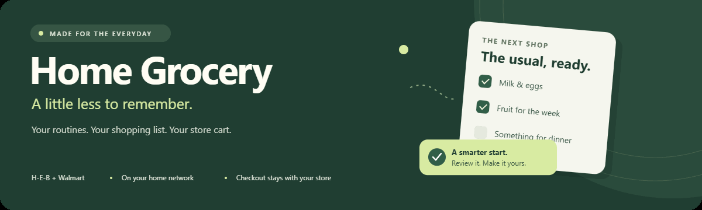
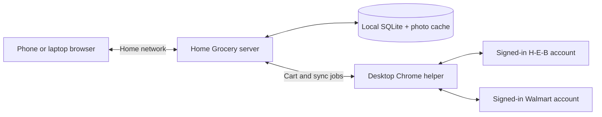

<picture>
  <source media="(prefers-reduced-motion: reduce)" srcset="docs/assets/banner.svg">
  
</picture>

<p align="center">
  A household grocery planner that turns familiar routines into a shopping list—<br>
  then sends your choices to <strong>H-E-B or Walmart</strong> for normal checkout.
</p>

<p align="center">
  
  
  
  
</p>

<p align="center">
  <a href="#a-look-inside">Preview</a> ·
  <a href="#what-it-does">Features</a> ·
  <a href="#getting-started">Setup</a> ·
  <a href="#your-data-and-rollback">Data & rollback</a>
</p>

## A look inside

### Your next shop, in one place

See your store cart, review items that may be due, and browse saved products.


<table>
  <tr>
    <td width="72%" valign="top">
      <h3>From a short list to specific products</h3>
      <p>Paste “milk, eggs, bread.” Review matches, adjust quantities, and send the choices you want.</p>
      
    </td>
    <td width="28%" valign="top">
      <h3>Built for your phone, too</h3>
      <p>The PC helper handles the store connection. Your phone uses the household website.</p>
      
    </td>
  </tr>
</table>

### Understand what you spend and how you shop

Weekly spending averages use full receipt totals, including recorded fees, taxes,
and tips. Purchase patterns help distinguish regular restocks from occasional buys.
Restock groups show the typical time between purchases separately from how
consistent that timing is, with the actual purchase gaps available for review.


<details>
  <summary><strong>See the weekly charts and restock patterns</strong></summary>


</details>

*All screenshots use fictional demo data and illustrated product thumbnails.
They show the real interface without exposing household purchases or account details.*

## What it does

| For the household | How it helps |
| --- | --- |
| **Suggest a shopping list** | Uses repeat purchases from both stores to propose items and quantities for review. Timing updates as days pass. |
| **Paste a family member’s list** | Matches short names to saved products. Save what “milk” means for each store and define extras such as “when butter is requested, suggest papaya.” |
| **Shopping packs** | Review groups bought together, choose all or some items, and save your own named packs. |
| **Store-aware carts** | Keep H-E-B and Walmart carts separate. Add, change, or remove items and follow the selected store to checkout. |
| **Automatic H-E-B coupons** | Clips offers for cart products, reloads to verify the saved state, and shows requirements and coupon-check progress. It never adds qualifying products automatically. |
| **Purchase history** | Imports receipts from both stores, retaining prices, discounts, quantities, and weight units. Cart changes alone do not train purchase habits. |
| **Spending & habits** | Shows average weekly spending, frequent purchases, restock intervals, and supported savings insights. |
| **Cross-store product matches** | Links equivalent products with editable package-size ratios so purchases at either store can inform suggestions. |
| **Photos and prices** | Caches product images locally and collects store prices through the helper. Comparisons show when prices were checked; they are not guaranteed live quotes. |
| **Weekly history sync** | Runs Monday at **2 a.m. America/New_York**, catches up after downtime, and skips already verified receipts. |

Suggestions estimate shopping timing, not inventory in your kitchen. You review
the list; checkout and payment stay on the store’s website. A clipped coupon can
still require a minimum quantity, spend, or other conditions.

## How it fits together



The hosting PC runs the server. The Chrome extension uses that PC’s store
sessions to do the retailer work. Any supported browser on the home network can
use the website, including a phone—no mobile extension is required.

Windows Task Scheduler starts the configured household server independently of
Codex. The server owns the Monday schedule; Codex does not need to stay open.
The PC must be awake, and store sign-ins or human checks can require attention.

## Getting started

This is a **Windows-first household application**, currently tailored to the
hosting PC and home-network configuration. The scheduled task, Chrome-profile
links, and friendly network name are machine setup, not something Git installs.

### 1. Start the website

Requires **Node.js 22.13+** and **desktop Google Chrome 120+** for the helper.

```powershell
git clone https://github.com/averytorres/ShoppingApp.git
cd ShoppingApp
npm ci
npm start
```

Open **http://localhost:4317** on the hosting PC. Other home devices use
**http://groceries.local** on the configured network, or
`http://<hosting-PC-IP>:4317` when local-name resolution is unavailable.

On the existing hosting PC, use its **Home Grocery Server** scheduled task for
normal operation. `start-groceries.ps1` is the task’s background launcher.

### 2. Load the Chrome helper

1. Open `chrome://extensions` in the Chrome profile used for store shopping.
2. Turn on **Developer mode**, choose **Load unpacked**, and select
   [`walmart-extension/`](walmart-extension/).
3. Open **Home Grocery Helper**, set the household address to
   `http://127.0.0.1:4317` on the hosting PC, and connect the household.
4. Sign into the intended H-E-B and Walmart accounts in that profile. Complete
   any store human checks yourself.
5. In the website’s **Settings → Connected accounts**, link the account to its
   matching Chrome profile for automatic browser launch.

The folder’s original name is historical: the helper supports **both stores**.
Walmart may require one normal cart change to learn its request format. Store
credentials remain in Chrome’s store sessions.

### 3. Make it yours

- Choose the main store and default household account.
- Check for purchase history in **Settings**, or use **History** to preview an import.
- In **Paste a list**, review ambiguous matches and save usual product choices.
- Add household-specific extras and custom packs as you learn what works.
- Review suggested items and quantities before sending them to the store cart.

## Your data and rollback

| Saved in Git | Saved locally, excluded from Git |
| --- | --- |
| Website, server, Chrome helper | Household SQLite database and receipts |
| Dependency manifest and lockfile | Cached product photos and data backups |
| Startup and backup scripts | Browser profiles, store sessions, credentials |
| Documentation and demo images | Installed dependencies and runtime logs |

**Code history and household backups solve different problems.** Reverting a
commit restores code; it does not restore receipts, undo a schema change, or
change the retailer’s cart.

Create a complete database-and-photo backup while the server is running:

```powershell
node .\backup.js create
node .\backup.js verify "<backup-directory-printed-above>"
```

See [backup and recovery instructions](BACKUP-RECOVERY.txt) for verified restores,
read-only recovery previews, and activation. See [code rollback instructions](VERSION-CONTROL.md)
for commit snapshots and reverting changes.

## Project map

```text
ShoppingApp/
├── web/                    Household website and spending dashboard
├── walmart-extension/      Chrome helper for H-E-B and Walmart
├── server.js               Local API, live updates, and job coordination
├── heb-cart.js             H-E-B cart jobs and coupon reporting
├── history-*.js            Receipt import and price reconciliation
├── household-learning.js   Shared household-item learning
├── reorder.js              Restock timing and suggestions
├── shopping-packs.js       Learned and custom shopping packs
├── product-images.js       Local product-photo cache
├── weekly-history.js       Monday schedule and catch-up cycle
├── backup.js               Database/photo backup and recovery
├── start-groceries.ps1     Windows background server launcher
├── docs/assets/            README banner and demo screenshots
└── .data/                  Local household data — ignored by Git
```

## Current boundaries

- Store automation depends on signed-in Chrome sessions and retailer page/request formats.
- Headless Walmart operation is paused after repeated human checks; the regular
  Chrome helper is the working route.
- Cross-store matches are editable and incomplete; unmatched items need a choice.
- Store pages can change. Coupon failures, interrupted cart work, and sync issues
  are shown for review rather than silently treated as success.
- This app is intended for the trusted home network; it is not configured as a
  public, multi-user hosted service.

<p align="center"><sub>Home Grocery · Made for the everyday.</sub></p>
