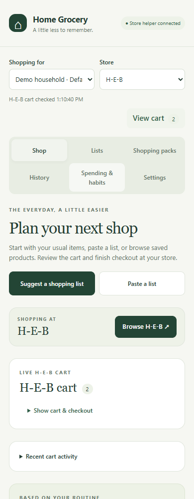
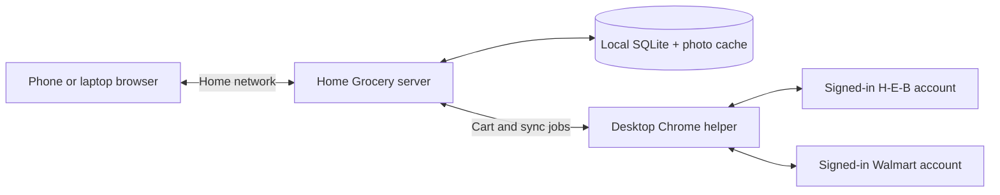

<picture>
  <source media="(prefers-reduced-motion: reduce)" srcset="docs/assets/banner.svg">
  
</picture>

<p align="center">
  <a href="https://github.com/averytorres/ShoppingApp/releases/latest/download/Install-Home-Grocery.exe"></a><br>
  <a href="https://github.com/averytorres/ShoppingApp/releases/latest">Release notes</a> ·
  <a href="https://github.com/averytorres/ShoppingApp/releases/latest/download/SHA256SUMS.txt">SHA-256 checksum</a>
</p>

Install once on the PC that stays on, then use the website from your phone or
laptop. The installer includes Node and dependencies. Chrome helper approval and
store sign-in are the remaining manual steps. **This repository is private:**
release downloads require a GitHub account with access to it.

<p align="center">
  A household grocery planner that turns familiar routines into a shopping list—<br>
  then sends your choices to <strong>H-E-B or Walmart</strong> for normal checkout.
</p>

<p align="center">
  
  
  
  
</p>

<p align="center">
  <a href="#a-look-inside">Preview</a> ·
  <a href="#what-it-does">Features</a> ·
  <a href="#getting-started">Setup</a> ·
  <a href="#your-data-and-rollback">Data & rollback</a>
</p>

## A look inside

### Your next shop, in one place

See your store cart, scan suggestions by grocery type, and browse saved products.
Timing reliability stays visible on each row; older habits remain collapsed.
Suggestions and saved products have pages plus a Show all option.


<table>
  <tr>
    <td width="72%" valign="top">
      <h3>From a short list to specific products</h3>
      <p>Paste “milk, eggs, bread.” Review matches, adjust quantities, and send the choices you want.</p>
      
    </td>
    <td width="28%" valign="top">
      <h3>Built for your phone, too</h3>
      <p>The PC helper handles the store connection. Your phone uses the household website.</p>
      
    </td>
  </tr>
</table>

### Understand what you spend and how you shop

Weekly spending averages use full receipt totals, including recorded fees, taxes,
and tips. Purchase patterns help distinguish regular restocks from occasional buys.
Restock groups show the typical time between purchases separately from how
consistent that timing is, with the actual purchase gaps available for review.


<details>
  <summary><strong>See the weekly charts and restock patterns</strong></summary>


</details>

*All screenshots use fictional demo data and illustrated product thumbnails.
They show the real interface without exposing household purchases or account details.*

## What it does

| For the household | How it helps |
| --- | --- |
| **Suggest a shopping list** | Separates regular restocks, variable or limited history, older habits, and alternatives. Only fairly regular recent items start selected. Quantities are starting amounts, with their evidence available to review. |
| **“We have enough”** | Snooze an automatic suggestion for a week or until a chosen date. Matching products at the other store are paused for the same account too. Resume early from the paused-items panel. |
| **Review by grocery type** | Suggested drafts, pasted lists, and carts use grocery categories. Review lists have category selection and quantity steppers; cart selection is for explicit bulk removal. |
| **Paste a family member’s list** | Matches short names to saved products. Save what “milk” means for each store and define extras such as “when butter is requested, suggest papaya.” |
| **Reusable household lists** | Save a reviewed list under a friendly name, keeping original requests alongside product choices and quantities. Reload it in **Lists**, review, then send. |
| **Shopping packs** | Shows when products were bought together without implying they are needed together now. Choose all or some items, review quantities, and save your own named packs. |
| **Store-aware carts** | Keep H-E-B and Walmart carts separate. Add, change, or remove items and follow the selected store to checkout. |
| **Checkout readiness** | Shows remaining cart changes, coupon checks, stale confirmations, or a cart ready for review beside the checkout link. |
| **Unavailable-item alternatives** | Review similar saved products with package sizes, checked prices, normalized unit prices, and dietary wording from their names. Edit the proposed quantity and optionally remember the replacement. Saved package-size ratios are used where available. |
| **Automatic H-E-B coupons** | Clips offers for cart products, reloads to verify the saved state, and shows requirements, per-product check times, and progress. Cart changes are flagged for eligibility review; qualifying products are never added automatically. |
| **Purchase history** | Imports receipts from both stores, retaining prices, discounts, quantities, and weight units. Cart changes alone do not train purchase habits. |
| **Spending & habits** | Shows average weekly spending, frequent purchases, restock intervals, and supported savings insights. |
| **Cross-store product matches** | Links equivalent products with editable package-size ratios so purchases at either store can inform suggestions. |
| **Photos and prices** | Caches product images locally and collects store prices through the helper. Comparisons show when prices were checked; they are not guaranteed live quotes. |
| **Price-drop watch** | Flags fresh drops of at least 5% and $0.10 for items bought on at least three recent purchase dates. Compares an earlier checked price or a comparable last-paid price and shows recorded offer conditions and expiry. |
| **Weekly history sync** | Runs Monday at **2 a.m. America/New_York**, catches up after downtime, and skips already verified receipts. |

Suggestions estimate shopping timing, not inventory in your kitchen. You review
the list; checkout and payment stay on the store’s website. A clipped coupon can
still require a minimum quantity, spend, or other conditions.

Alternatives come from saved products and reviewed matches, not the entire live
store catalog. Dietary notes are name-based clues: ingredients and allergens
still need a store-label check. Snoozed items stay out of automatic planning and
price-drop alerts until their resume date; saved lists remain available for
explicit review. Price watches depend on collected prices rather than continuous
retailer polling.

## How it fits together



The hosting PC runs the server. The Chrome extension uses that PC’s store
sessions to do the retailer work. Any supported browser on the home network can
use the website, including a phone—no mobile extension is required.

Installer setups start the server quietly at Windows sign-in using a Startup
shortcut. Existing source installations can keep their Windows scheduled task.
The server owns the Monday schedule; no coding app needs to stay open.
The PC must be awake, and store sign-ins or human checks can require attention.

## Getting started

### 1. Install on the hosting PC

1. [Download Install Home Grocery](https://github.com/averytorres/ShoppingApp/releases/latest/download/Install-Home-Grocery.exe) and run it on **Windows 10/11 x64**.
2. Enter a household name, choose H-E-B or Walmart, and select whether to start
   at Windows sign-in and allow phones on your private network.
3. Continue with the connection guide that opens in your browser.

No separate Node, npm, Git, or terminal setup is needed. The installer works
offline; store connections need internet access. Optional home-network access
asks for Windows administrator approval. Keep this PC awake and signed in.
The installer is currently **unsigned**, so Windows may show an unknown-publisher
or SmartScreen warning. The helper is not yet in the Chrome Web Store.

Open Home Grocery from the Windows Start menu. Phones on the same private network
can use **http://groceries.local**, or the numbered address in the connection guide
if the friendly name is unavailable. Phones do not need the extension.

**Already running from a source checkout?** Keep using it. Setup refuses to
replace an existing server on port 4317; it does not migrate your household data.

<details>
<summary><strong>Developer setup instead of the installer</strong></summary>

Requires Node.js 22.13+ and desktop Google Chrome 120+.

```powershell
git clone https://github.com/averytorres/ShoppingApp.git
cd ShoppingApp
npm ci
npm start
```

Open http://localhost:4317. For an existing scheduled-task installation,
`start-groceries.ps1` remains its background launcher. Building a new installer
is documented in [installer/README.md](installer/README.md).

</details>

### 2. Load the Chrome helper

1. Open `chrome://extensions` in the Chrome profile used for store shopping.
2. Turn on **Developer mode**, choose **Load unpacked**, and select
   the folder shown by the installer’s connection guide. You can also open it
   using **Start → Home Grocery → Chrome extension folder**. For a source checkout,
   choose [`walmart-extension/`](walmart-extension/).
3. Open **Home Grocery Helper**, set the household address to
   `http://127.0.0.1:4317` on the hosting PC, and connect the household.
4. Sign into the intended H-E-B and Walmart accounts in that profile. Complete
   any store human checks yourself.
5. In the website’s **Settings → Connected accounts**, link the account to its
   matching Chrome profile for automatic browser launch.

The folder’s original name is historical: the helper supports **both stores**.
Walmart may require one normal cart change to learn its request format. Store
credentials remain in Chrome’s store sessions.

### 3. Make it yours

- Choose the main store and default household account.
- Check for purchase history in **Settings**, or use **History** to preview an import.
- In **Lists**, paste a request or load a saved household list, review matches,
  and save usual product choices. Save the reviewed list under a friendly name
  to reuse its original requests and product selections next time.
- Add household-specific extras and custom packs as you learn what works.
- Review suggested items and quantities before sending them to the store cart.

## Updates and uninstall

To update, download and run the latest installer again. It preserves household
data and creates a verified database/photo backup before updating an existing
installation. Reload the Chrome helper after an update. Updates are manual.

Uninstall through **Windows Settings → Apps → Home Grocery** or its Start-menu
shortcut. Your household data and backups are kept. Remove the helper separately
in Chrome. Installer data is stored in `%LOCALAPPDATA%\HomeGrocery\data`;
program files are in `%LOCALAPPDATA%\Programs\HomeGrocery`.

## Your data and rollback

| Saved in Git | Saved locally, excluded from Git |
| --- | --- |
| Website, server, Chrome helper | Household SQLite database and receipts |
| Dependency manifest and lockfile | Cached product photos and data backups |
| Startup and backup scripts | Browser profiles, store sessions, credentials |
| Documentation and demo images | Installed dependencies and runtime logs |

**Code history and household backups solve different problems.** Reverting a
commit restores code; it does not restore receipts, undo a schema change, or
change the retailer’s cart.

For an installer setup, create a complete database/photo backup with the bundled
runtime (no separate Node needed):

```powershell
& "$env:LOCALAPPDATA\Programs\HomeGrocery\runtime\node.exe" "$env:LOCALAPPDATA\Programs\HomeGrocery\app\backup.js" create "$env:LOCALAPPDATA\HomeGrocery\data"
```

For a source checkout, run these from the project folder:

```powershell
node .\backup.js create
node .\backup.js verify "<backup-directory-printed-above>"
```

See [backup and recovery instructions](BACKUP-RECOVERY.txt) for verified restores,
read-only recovery previews, and activation. See [code rollback instructions](VERSION-CONTROL.md)
for commit snapshots and reverting changes.

## Project map

```text
ShoppingApp/
├── installer/              Windows installer source and build instructions
├── web/                    Household website and spending dashboard
├── walmart-extension/      Chrome helper for H-E-B and Walmart
├── server.js               Local API, live updates, and job coordination
├── heb-cart.js             H-E-B cart jobs and coupon reporting
├── history-*.js            Receipt import and price reconciliation
├── household-learning.js   Shared household-item learning
├── reorder.js              Restock timing and suggestions
├── shopping-packs.js       Learned and custom shopping packs
├── product-images.js       Local product-photo cache
├── weekly-history.js       Monday schedule and catch-up cycle
├── backup.js               Database/photo backup and recovery
├── start-groceries.ps1     Windows background server launcher
├── docs/assets/            README banner and demo screenshots
└── .data/                  Local household data — ignored by Git
```

## Current boundaries

- Store automation depends on signed-in Chrome sessions and retailer page/request formats.
- Headless Walmart operation is paused after repeated human checks; the regular
  Chrome helper is the working route.
- Cross-store matches are editable and incomplete; unmatched items need a choice.
- Store pages can change. Coupon failures, interrupted cart work, and sync issues
  are shown for review rather than silently treated as success.
- This app is intended for the trusted home network; it is not configured as a
  public, multi-user hosted service.

<p align="center"><sub>Home Grocery · Made for the everyday.</sub></p>
