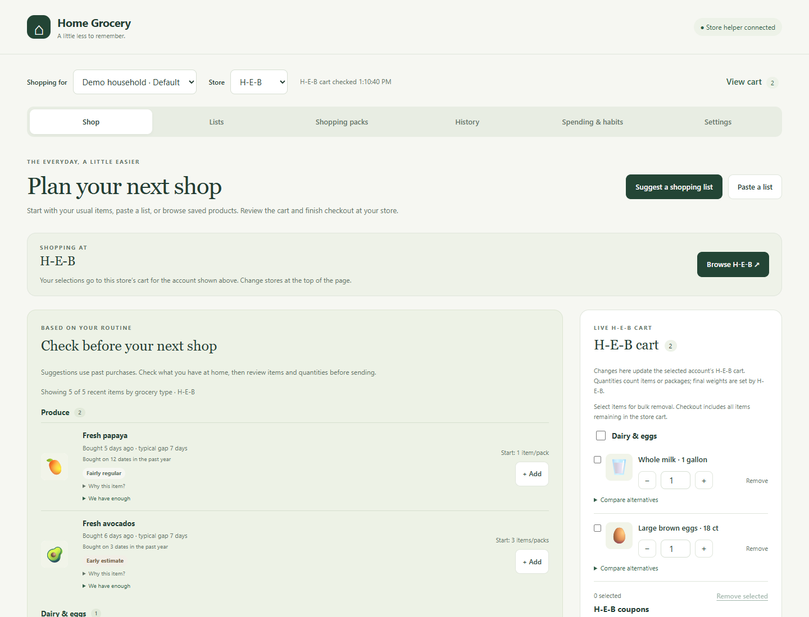
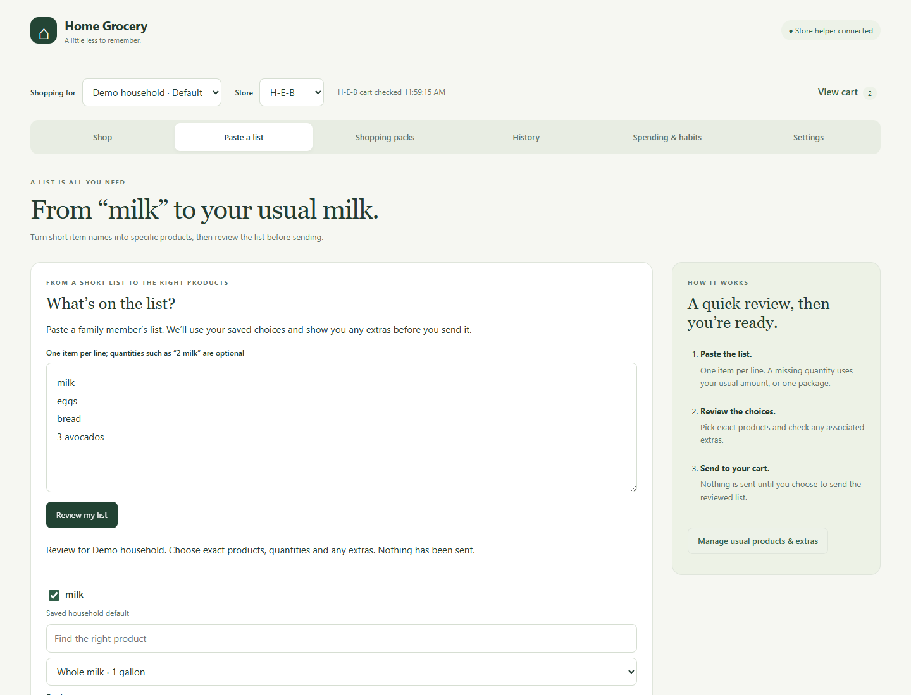
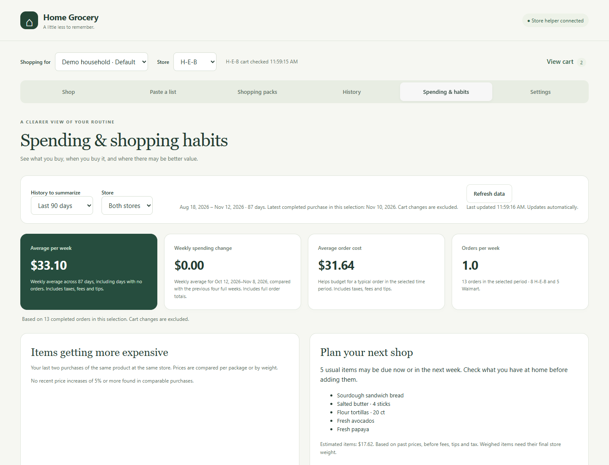
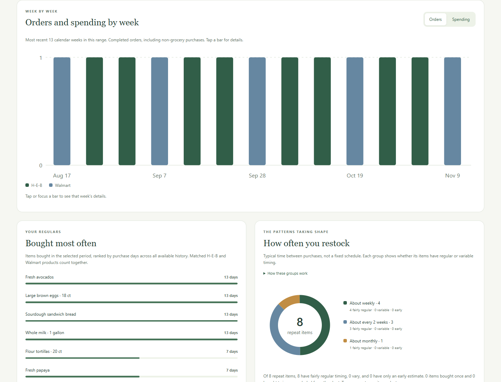

<picture>
  <source media="(prefers-reduced-motion: reduce)" srcset="docs/assets/banner.svg">
  
</picture>

   
  <a href="https://github.com/averytorres/ShoppingApp/releases/latest">Release notes</a> ·
  <a href="https://github.com/averytorres/ShoppingApp/releases/latest/download/SHA256SUMS.txt">SHA-256 checksum</a>

Install once on the PC that stays on, then use the website from your phone or
laptop. The installer includes Node and dependencies. Chrome helper approval and
store sign-in are the remaining manual steps. **This repository is private:**
release downloads require a GitHub account with access to it.

  A household grocery planner that turns familiar routines into a shopping list— 
  then sends your choices to <strong>H-E-B or Walmart</strong> for normal checkout.

  
  
  
  

  <a href="#a-look-inside">Preview</a> ·
  <a href="#what-it-does">Features</a> ·
  <a href="#getting-started">Install</a> ·
  <a href="docs/USER-GUIDE.md">User guide</a> ·
  <a href="docs/TROUBLESHOOTING.md">Help</a>

## A look inside

### Your next shop, in one place

See your store cart, scan suggestions by grocery type, and browse saved products.
Timing reliability stays visible on each row; older habits remain collapsed.
Suggestions and saved products have pages plus a Show all option.

<table>
  <tr>
    <td width="72%" valign="top">
      <h3>From a short list to specific products</h3>
      
Paste “milk, eggs, bread.” Review matches, adjust quantities, and send the choices you want.

      
    </td>
    <td width="28%" valign="top">
      <h3>Built for your phone, too</h3>
      
The PC helper handles the store connection. Your phone uses the household website.

      
    </td>
  </tr>
</table>

### Understand what you spend and how you shop

Weekly spending averages use full receipt totals, including recorded fees, taxes,
and tips. Purchase patterns help distinguish regular restocks from occasional buys.
Restock groups show the typical time between purchases separately from how
consistent that timing is, with the actual purchase gaps available for review.

  
<strong>See the weekly charts and restock patterns</strong>

*All screenshots use fictional demo data and illustrated product thumbnails.
They show the real interface without exposing household purchases or account details.*

## What it does

- **Plan your shop:** suggestions based on your purchase history, with clear
  reasons and “We have enough” snoozes when you are stocked up.
- **Turn short lists into products:** paste “milk, bread, butter,” review matches
  and quantities by grocery type, and save a named list for next time.
- **Shop either store:** separate H-E-B and Walmart carts, live sync status, and
  checkout on the selected store’s website.
- **Find better value:** H-E-B coupon clipping, checked-price comparisons,
  saved-product alternatives, and price-drop alerts for regular purchases.
- **Understand your habits:** receipt history from both stores, average weekly
  spending, purchase patterns, and locally cached product photos.

You review products and quantities before sending a list. Checkout and payment
stay on the retailer’s website. Suggestions estimate timing, not what is in your
kitchen. Prices and coupon eligibility can change; confirm them at checkout.

## Getting started

You need **Windows 10/11 x64**, desktop **Google Chrome 120+**, and a private home
network. Keep the hosting PC awake and signed in. Only that PC needs installation;
phones and other laptops use the website.

1. [Download Install Home Grocery](https://github.com/averytorres/ShoppingApp/releases/latest/download/Install-Home-Grocery.exe) and run it on the hosting PC. Node and dependencies are included.
2. Enter a household name, choose your main store, and select startup and
   private-network preferences. The network option asks for Windows approval.
3. Follow the connection guide that opens: approve the bundled Chrome helper,
   sign into your stores in Chrome, and connect the household.
4. Open Home Grocery from the Windows Start menu. On your phone, open
   **http://groceries.local**, or the numbered address in the connection guide.

The installer is **unsigned**, so Windows may show an unknown-publisher or
SmartScreen warning. The helper is not yet in the Chrome Web Store; approving it
and signing into stores are manual steps. Store human checks can require attention.

[Follow the full setup and first-shop guide →](docs/USER-GUIDE.md)

Already using a source installation? Keep using it. The installer does not replace
an existing server on port 4317 or migrate its household data.

## Your data and updates

Household data stays on the hosting PC. It is not included in the installer or
uploaded to this repository. Store sign-ins stay in Chrome. Use a trusted private
network; this is not a public hosted service with separate website logins.

Download and run a newer installer to update. Existing household data is retained,
a database/photo backup is verified before updates, and the Chrome helper needs
reloading afterward. Updates are manual. Uninstall keeps household data and
backups; remove the helper separately in Chrome.

## Guides and help

| I want to… | Read |
| --- | --- |
| Connect accounts, import history, and shop | [User guide](docs/USER-GUIDE.md) |
| Fix connection, cart, coupon, or sync problems | [Troubleshooting](docs/TROUBLESHOOTING.md) |
| Back up or recover household data | [Backup and recovery](BACKUP-RECOVERY.txt) |
| Develop or contribute changes | [Contributing](CONTRIBUTING.md) |
| Build a Windows installer | [Installer developer guide](installer/README.md) |
| Roll back a code change | [Version control](VERSION-CONTROL.md) |

Home Grocery · Made for the everyday.

